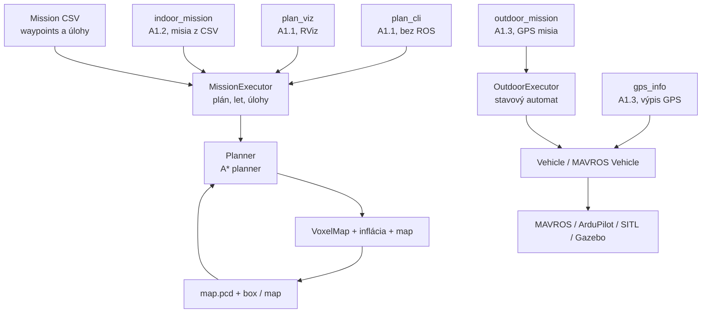
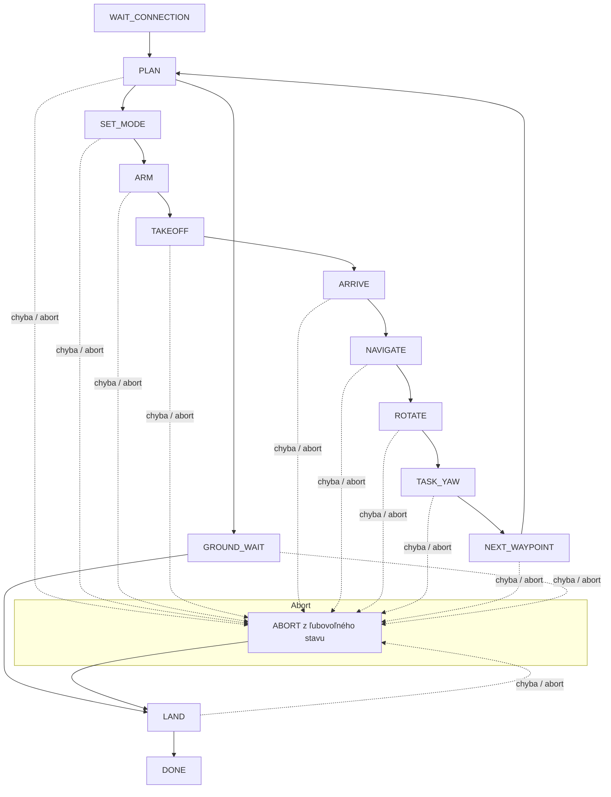

# LRS – Zadanie č.1 - Autonómne plánovanie a vykonávanie misie

Tento repozitár obsahuje implementáciu systému pre autonómne riadenie dronu v prostredí ROS 2. Cieľom zadania je:
- plánovanie trasy v mape,
- vykonávanie indoor misii,
- vykonávanie outdoor misii s GPS,
- vizualizáciu plánu a trajektórie.

Repozitár je rozdelený do dvoch hlavných modulov:
- `lrs_planning` – plánovanie a mapové operácie,
- `lrs_control` – správa misií, stavový automat, MAVROS integrácia, outdoor/internetčná logika.

---

## Obsah

- [Prehľad zadania](#prehľad-zadania)
- [Štruktúra repozitára](#struktúra-repozitára)
- [Architektúra systému](#architektúra-systému)
- [Požiadavky](#požiadavky)
- [Build projektu](#build-projektu)
- [Spustenie plánovača](#spustenie-plánovača)
- [Indoor misia](#indoor-misia)
- [Outdoor misia](#outdoor-misia)
- [Stavový automat](#stavový-automat)

---

## Prehľad zadania

Zadanie je rozdelený na viacero úloh:

1. A1.1 – plánovanie trasy v mape
2. A1.2 – indoor misia a vykonávanie úloh v uzavretom prostredí
3. A1.3 – outdoor misia s GPS a automatizovaným leteckým správaním

---

## Štruktúra repozitára

```text
LRS_Maslen_Kormanikova/
├── README.md
├── .gitignore
├── docs/
├── src/
│   ├── lrs_planning/
│   │   ├── apps/
│   │   │   └── plan_cli.cpp
│   │   ├── config/
│   │   │   └── planning.yaml
│   │   ├── include/
│   │   │   └── lrs_planning/
│   │   ├── src/
│   │   │   ├── astar_planner.cpp
│   │   │   ├── inflation.cpp
│   │   │   ├── path_simplifier.cpp
│   │   │   ├── planning_algorithm.cpp
│   │   │   └── voxel_map.cpp
│   │   ├── CMakeLists.txt
│   │   └── package.xml
│   │
│   └── lrs_control/
│       ├── config/
│       │   ├── indoor.yaml
│       │   └── outdoor.yaml
│       ├── include/
│       │   └── lrs_control/
│       ├── missions/
│       │   ├── exam_example.csv
│       │   ├── mission_3_all.csv
│       │   └── test_open.csv
│       ├── rviz/
│       │   ├── lrs.rviz
│       │   └── outdoor.rviz
│       ├── scripts/
│       │   ├── plot_outdoor.py
│       │   └── record_outdoor.sh
│       ├── src/
│       │   ├── gps_info_node.cpp
│       │   ├── indoor_mission_node.cpp
│       │   ├── mavros_vehicle.cpp
│       │   ├── mission.cpp
│       │   ├── mission_executor.cpp
│       │   ├── outdoor_executor.cpp
│       │   ├── outdoor_mission_node.cpp
│       │   ├── plan_viz_node.cpp
│       │   └── viz.cpp
│       ├── test/
│       │   ├── geo_test.cpp
│       │   ├── mission_sim.cpp
│       │   ├── outdoor_sim.cpp
│       │   └── sim_vehicle.hpp
│       ├── CMakeLists.txt
│       └── package.xml
```

---

## Architektúra systému


---

## Build projektu

- v prvom rade si vytvoríme pracovný priestor a naklonujeme zadanie z main vetvy

```bash
source /opt/ros/$ROS_DISTRO/setup.bash
mkdir -p ~/lrs_ws/src
cd ~/lrs_ws/src
git clone https://github.com/D0mc1c1/LRS_Maslen_Kormanikova.git
cd ~/lrs_ws
```

- zbuildíme naklonované zadanie
  
```bash
source /opt/ros/$ROS_DISTRO/setup.bash
cd ~/lrs_ws
colcon build --symlink-install
source install/setup.bash
```

## A1.1 – plánovač
- spustíme plánovač a pracujeme s mapou v PCD formáte

```bash
MAP=~/LRS-URK/maps/FEI_LRS_PCD/map.pcd
ros2 run lrs_planning plan_cli $MAP 13 7 1 8.65 2.02 1 [radius=0.5]
```
- plánovanie celej misie z csv

```bash
MAP=~/LRS-URK/maps/FEI_LRS_PCD/map.pcd
ros2 run lrs_planning plan_cli $MAP --mission src/lrs_control/missions/exam_example.csv
```
- skontrola obsadenosti bodu

```bash
MAP=~/LRS-URK/maps/FEI_LRS_PCD/map.pcd
ros2 run lrs_planning plan_cli $MAP --query 5.945 6.818 2.45
```

## A1.2 – indoor misia

V `src/lrs_control/config/indoor.yaml` nastav `map_path`. Potom 3 terminály podľa LRS-URK README (Gazebo, SITL, MAVROS) a:

- Indoor časť rieši misie v uzavretom priestore, kde nie je potrebné používať GPS. Vytvára sa plán z mapy a následne sa vykonáva postupnosť úloh.
- 
```bash
ros2 run lrs_control indoor_mission --ros-args \
  --params-file src/lrs_control/config/indoor.yaml \
  -p mission_file:=src/lrs_control/missions/exam_example.csv
```

- `mission_file` – ľubovoľné CSV `x,y,z,precision,task` (map frame)
- `planner:=astar` (default) – A* z A1.1
- abort počas letu: `ros2 service call /indoor_mission/abort std_srvs/srv/Trigger`

### Offline test (bez ROS a simulátora)

```bash
SIM_MAP=$MAP ros2 run lrs_control mission_sim src/lrs_control/missions/exam_example.csv   # A* + stavovy automat
ros2 run lrs_control mission_sim src/lrs_control/missions/test_open.csv                   # priamky
```

## A1.3 – outdoor misia

Outdoor časť je zameraná na GPS navigáciu, prácu s lokálnym ENU súradnicovým systémom a správu letu dronu.

### Simulácia (outdoor svet)

```bash
cd ~/LRS-URK && scripts/run_gazebo.sh fei_lrs_outdoor.world                          # terminál 1
cd ~/LRS-URK && HOME_LOCATION=48.15144444,17.07375000,150,0 scripts/run_sitl.sh      # terminál 2
cd ~/LRS-URK && scripts/run_mavros.sh                                                # terminál 3
```

### Časť 1: GPS, home, kompas

```bash
ros2 run lrs_control geo_test      # prevod LLA <-> ENU a kompasu, bez ROS
ros2 run lrs_control gps_info      # 1 Hz: lat/lon/alt, ENU od home, local position, kurz
```


### Časť 2: vzlet, stabilné držanie, pristátie

Stavy: `WAIT_CONNECTION → WAIT_GPS → WAIT_ORIGIN → SET_MODE → ARM → TAKEOFF → HOLD → LAND → DONE`
(+ `ABORT`). Bez použiteľného GPS dron **nearmuje**. Ak pilot prepne mód z RC, program
prestane posielať setpointy a nič neprikazuje (nebojuje s pilotom).

```bash
ros2 run lrs_control outdoor_sim normal    # offline test, aj: nohome nogps rc abort
ros2 run lrs_control outdoor_mission --ros-args --params-file src/lrs_control/config/outdoor.yaml
ros2 service call /outdoor_mission/abort std_srvs/srv/Trigger    # núdzové pristátie
```

### Časť 3: štvorec s natáčaním na POI

Po vzlete sa dron natočí na POI, preletí na W1 a obletí štvorec W1→W2→W3→W4→W1 (S = 5 m,
stred = POI). Smer na POI sa počíta **každý tick** zo skutočnej polohy, len vodorovne
(yaw, nie gimbal). Úseky majú lichobežníkový profil rýchlosti; do setpointu ide aj rýchlosť
a rýchlosť otáčania ako feedforward. Na konci sa vráti nad miesto vzletu a pristane.

```bash
ros2 run lrs_control outdoor_sim normal    # aj: noff setpoint latlon nohome nogps geofence rc abort
ros2 run lrs_control outdoor_mission --ros-args --params-file src/lrs_control/config/outdoor.yaml
# POI cez lat/lon:  ... -p poi_lat:=48.1514867 -p poi_lon:=17.0737554
```

### Časť 4: osmička (časová trajektória)

Po štvorci presun do stredu nad POI (yaw sa cestou plynulo stočí na tangentu), potom
`x = A sin θ, y = A sin θ cos θ`, `θ = ω·(now − t_start)` – v každom ticku riadiaceho
timera (20 Hz) nový setpoint (poloha + rýchlosť + yaw = tangenta + yaw_rate). Yaw je
unwrapnutý. Rozbeh/dobeh fázy `fig8_ramp` odstráni skok rýchlosti na štarte.

```bash
ros2 run lrs_control outdoor_sim normal    # aj: noramp fast toofast noff abort ...
ros2 run lrs_control outdoor_mission --ros-args --params-file src/lrs_control/config/outdoor.yaml
# pomalšie:  ... -p fig8_omega:=0.15
```

### Časť 5: abort, zásah pilota, strata spojenia (indoor aj outdoor)

| Udalosť | Reakcia programu |
|---|---|
| `~/abort` alebo chyba misie (timeout, odchýlka) | prepne do `abort_mode` (outdoor LAND/RTL/BRAKE/LOITER, indoor vždy LAND); po potvrdení módu node skončí |
| pilot prepne mód z RC, disarm vo vzduchu | **prestane posielať setpointy, nič neprikazuje** (nebojuje s pilotom), node skončí |
| MAVROS spadne / FCU odpojené (`/mavros/state` > 3 s, poloha > 1 s) | to isté – prestane riadiť, ArduPilot drží pozíciu, ďalej pilot a failsafe |

```bash
ros2 service call /outdoor_mission/abort std_srvs/srv/Trigger
ros2 service call /indoor_mission/abort std_srvs/srv/Trigger
ros2 run lrs_control outdoor_sim rc          # aj: abort abortrtl linkloss
SIM_RC=30 ros2 run lrs_control mission_sim src/lrs_control/missions/test_open.csv   # aj SIM_ABORT, SIM_LINK
```

### Časť 6: rosbag a graf preletenej vs. prikázanej trasy

`outdoor_mission` publikuje fázu misie (`/lrs/outdoor/state`), POI, plánovanú trasu,
značky a preletenú trasu (`/lrs/outdoor/*`, frame `map` = MAVROS local ENU). Prikázaná
trajektória je `/mavros/setpoint_raw/local`, skutočná `/mavros/local_position/pose`.

```bash
# terminál 4: záznam (spustiť PRED misiou, Ctrl+C po pristátí)
ros2 run lrs_control record_outdoor.sh ~/lrs_bags/outdoor_run1
# terminál 5: misia
ros2 run lrs_control outdoor_mission --ros-args --params-file src/lrs_control/config/outdoor.yaml
# RViz (voliteľne)
rviz2 -d src/lrs_control/rviz/outdoor.rviz
# graf + súhrn (chyba na POI, odchýlka osmičky, yaw vs. tangenta, rozmery, geofence)
ros2 run lrs_control plot_outdoor.py ~/lrs_bags/outdoor_run1
# bez Gazeba: záznam z offline simulácie
SIM_CSV=/tmp/sim.csv ros2 run lrs_control outdoor_sim normal && ros2 run lrs_control plot_outdoor.py --csv /tmp/sim.csv
```

Výstup: `outdoor_xy.png` (pohľad zhora + detail osmičky), `outdoor_poi.png`,
`outdoor_fig8.png`, `outdoor_alt.png` v adresári bagu.

---

## Stavový automat

Stavový automat je srdcom vykonávania misie. V procese sa prechádza cez jednotlivé fázy, pričom systém kontroluje bezpečnostné podmienky, aborty, pilotov zásah a GPS/komunikáciu.



